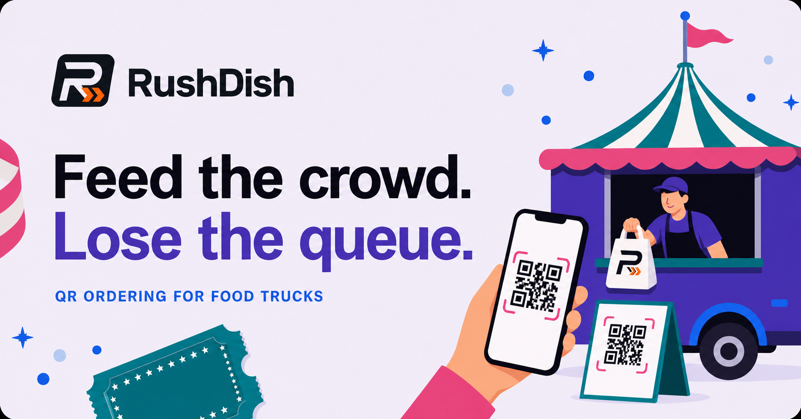

# RushDish



RushDish is an interactive QR-ordering concept for food trucks, festivals,
markets, and event kitchens.

Guests can build an order from their phone while crew members see the same
order move through received, cooking, ready, and collected states.

[View the live demo](https://rushdish-festival-orders.neotasticproductions.chatgpt.site/)

> [!IMPORTANT]
> This repository currently contains a browser-based product prototype. It does
> not process payments, save orders, or transmit enquiry-form data.

## Prototype highlights

- Guest menu with quantities and GBP totals
- Guest-to-crew demo order flow
- Received, cooking, ready, and collected order states
- Pause and resume controls for incoming orders
- Adjustable pickup estimates and rush modes
- Live item availability and sold-out controls
- Responsive product, pricing, FAQ, and enquiry experiences
- Project-specific social sharing and brand assets

## Technology

- Next.js 16 and React 19
- TypeScript
- Tailwind CSS 4 with custom CSS
- vinext and Vite
- Cloudflare Workers runtime
- ESLint and the Node.js test runner
- Optional Drizzle/D1 scaffolding; no database is currently connected

## Local development

Requires Node.js 22.13 or newer.

```bash
npm ci
npm run dev
```

Open the local URL printed by the development server.

## Commands

| Command | Purpose |
| --- | --- |
| `npm run dev` | Start the local development server |
| `npm run build` | Create a production build |
| `npm run start` | Run the production build locally |
| `npm run lint` | Run ESLint |
| `npm test` | Build and test the rendered RushDish page |
| `npm run db:generate` | Generate Drizzle migrations if a schema is added |

## Deployment

The hosted demo is configured for OpenAI Sites. The application is built
through vinext for a Cloudflare Workers-compatible runtime.

`.openai/hosting.json` currently declares no D1 database or R2 bucket. Use the
Sites publishing workflow for this configuration; another hosting provider
will require its own runtime and deployment setup.

## Project status

RushDish is presently an interactive product and design prototype.

Before accepting real orders, the project still needs a persistent order
model, payment-provider integration and webhooks, authenticated crew access,
real-time multi-device updates, production enquiry handling, and operational
and security testing.
